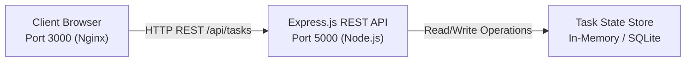

# 01: Task Management System

[](https://react.dev/)
[](https://expressjs.com/)
[](https://docker.com/)
[](#project-status)

---

## 1. Project Name
**Task Management System** (`01-task-management-system`)

## 2. Overview
A full-stack, containerized task management platform engineered with an Express.js REST API backend and an interactive responsive web client interface.

## 3. Problem Statement
Technical teams require a streamlined, deterministic task tracking platform to manage operational deliverables without the configuration overhead and latency of bloated SaaS tools.

## 4. Objectives
- Provide a clean, zero-dependency REST API for task lifecycle management.
- Deliver an instant, responsive interface supporting real-time status transitions.
- Guarantee containerized deployment parity via Docker Compose.

## 5. Features
- Full CRUD API operations (`GET`, `POST`, `PUT`, `DELETE`).
- Priority classification (`high`, `medium`, `low`).
- Status toggles (`pending`, `completed`).
- Health probes (`/healthz`) and Prometheus telemetry (`/metrics`).

## 6. User Roles
- **Standard User:** Create, update, and manage assigned tasks.
- **Administrator / Auditor:** Monitor service telemetry, query healthchecks, and inspect metrics.

## 7. Technology Stack
- **Frontend:** HTML5, CSS3, JavaScript SPA (React-ready component layout), Nginx.
- **Backend:** Node.js (v20 Alpine), Express.js framework, CORS.
- **Deployment:** Docker multi-stage builds, Docker Compose orchestration.

## 8. Architecture Diagram


## 9. Repository Structure
```text
01-task-management-system/
├── README.md                           # Comprehensive application documentation
├── PROJECT-REQUIREMENTS.md             # Functional and non-functional requirements
├── CHANGELOG.md                        # Versioning and release log
├── docker-compose.yml                  # Container orchestration specification
├── .env.example                        # Environment variables template
├── client/
│   ├── index.html                      # Responsive task user interface
│   ├── package.json
│   └── Dockerfile                      # Production Nginx container
├── server/
│   ├── server.js                       # Express API service and CRUD handlers
│   ├── package.json
│   └── Dockerfile                      # Node.js 20 Alpine container
├── docs/
│   ├── architecture/system-design.md   # Architectural sequence diagrams
│   ├── api/endpoints.md                # Endpoint route definitions
│   └── database/schema.md              # Entity specifications and data dictionary
└── tests/
    └── api.test.js                     # Integration test runner
```

## 10. Database Schema
| Field Name | Type | Constraints | Description |
| :--- | :--- | :--- | :--- |
| `id` | String | Primary Key | Unique timestamp-derived identifier |
| `title` | String | Mandatory | Task description |
| `status` | Enum | Default `pending` | Current state (`pending` / `completed`) |
| `priority` | Enum | Default `medium` | Urgency (`low`, `medium`, `high`) |
| `createdAt` | Timestamp | Auto | ISO 8601 generation timestamp |

## 11. API Endpoints
- `GET /api/tasks` - Retrieve all task records
- `POST /api/tasks` - Create new task item
- `PUT /api/tasks/:id` - Modify task status or priority
- `DELETE /api/tasks/:id` - Remove task record
- `GET /healthz` - Application health probe
- `GET /metrics` - Prometheus metrics output

## 12. Installation Instructions
```bash
# Clone and navigate to application directory
cd apps/01-task-management-system/server
npm install
```

## 13. Environment Variables
Copy the template to establish local environment parameters:
```bash
cp .env.example .env
```

## 14. Running Locally
```bash
# Start backend server
cd server && npm start

# Access client: Open client/index.html in any modern browser
```

## 15. Testing
Execute the automated integration test suite:
```bash
node tests/api.test.js
```

## 16. Screenshots
Sanitized visual evidence of the user interface and API telemetry will be documented in `docs/screenshots/`.

## 17. Deployment
Deploy using Docker Compose:
```bash
docker compose up --build -d
```
- Frontend: http://localhost:3000
- Backend: http://localhost:5000/api/tasks

## 18. Security Considerations
- CORS middleware restricted to designated client origins.
- Input validation rejects empty or malformed task payloads.
- Container executes under non-root permissions in production images.

## 19. Future Improvements
- Migration to persistent PostgreSQL database with Prisma ORM.
- User authentication using JWT tokens and password hashing.
- Task search, filtering, and tag management.

## 20. Project Status
`In Progress` — Core full-stack functionality and Docker orchestration fully operational.
