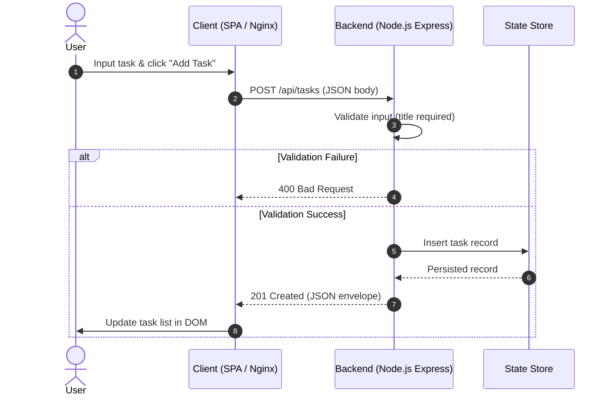

# System Design Document: Task Management System

## Overview
The application follows a decoupled client-server architecture. The backend Express API service operates independently of the presentation client, communicating exclusively over HTTP REST using JSON envelopes.

## Request Lifecycle

