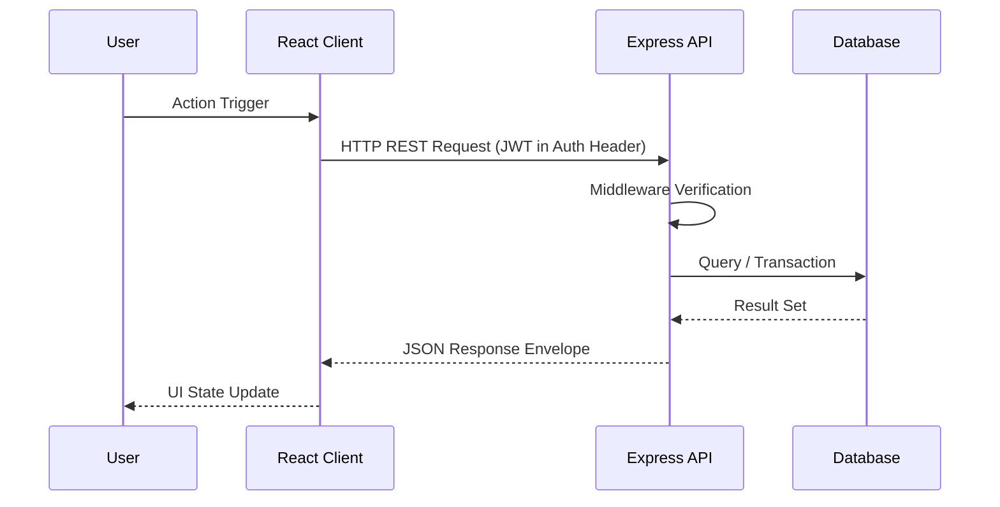

# [Application Name]

[](https://react.dev/)
[](https://nodejs.org/)
[](https://postgresql.org/)
[](https://docker.com/)

[Brief 2-3 sentence overview describing the business problem and core technical capabilities of the application].

---

## Features
- **Authentication & RBAC:** Secure JWT token handling, password hashing with bcrypt.
- **RESTful API:** Predictable endpoints with comprehensive HTTP error handling.
- **Responsive UI:** Clean, accessible user interface optimized for desktop and mobile.
- **Containerized Deployment:** Docker Compose orchestration for local development and cloud deployment.

---

## Architecture & Data Flow


---

## Quickstart & Local Setup

### Prerequisites
- Node.js v18+ or Docker & Docker Compose

### 1. Run with Docker Compose
```bash
docker compose up --build
```
- Frontend: http://localhost:3000
- Backend API: http://localhost:5000/api/v1/status

### 2. Manual Development Setup
```bash
# Backend
cd server && npm install && npm run dev

# Frontend
cd ../client && npm install && npm run dev
```
