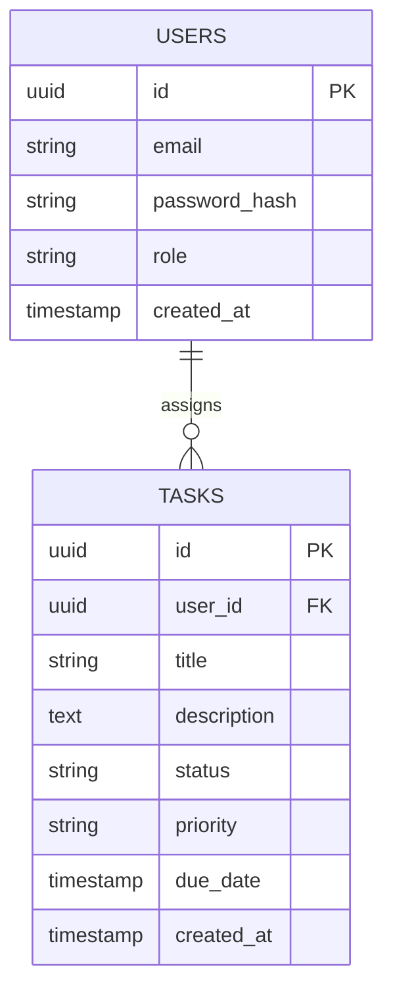

# Database Schema & Entity Relationships

## Entity-Relationship Diagram (ERD)

## Indexing & Performance Strategy
- Primary keys use UUID v4 for distributed uniqueness.
- Foreign keys (`user_id`) indexed to optimize join performance.
- Composite index on `(status, priority)` for filtered dashboard queries.
